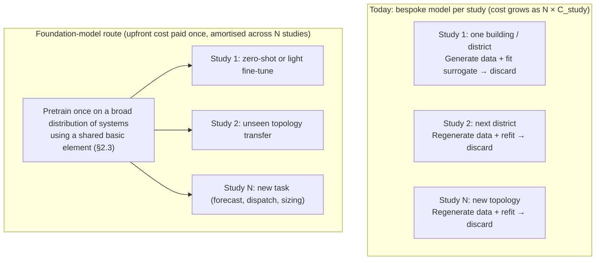

# Chapter 1 — Background: Urban Energy Systems and Foundation Models
{: .no_toc }



Orientation for a UES reader: what the domain is, what [foundation models](../appendices/a-glossary.html#foundation-model) (FMs) are at a glance, and why the two fields should meet now.
{: .fs-6 .fw-300 }

*The cost-structure contrast motivating these notes ([§1.4](1-4-why-now-and-how-to-use.html)):* paying training cost once and reusing it across studies only holds when the model's [basic element](../appendices/a-glossary.html#basic-element) carries over ([§2.3](../chapter-2-fm-foundations/2-3-choosing-a-basic-element.html), [§3.3](../chapter-3-sim-opt/3-3-energy-hub-formalism.html#the-amortisation-argument)).

## In this chapter

| § | Page | Covers |
| :--- | :--- | :--- |
| 1.1 | [What an urban energy system contains](1-1-what-is-ues.html) | Scales, carriers, the [energy hub](../appendices/a-glossary.html#energy-hub) abstraction |
| 1.2 | [FMs in one page](1-2-fms-in-one-page.html) | What changed in AI since ~2018, in non-technical terms |
| 1.3 | [The FM landscape and where it is heading](1-3-fm-landscape-by-domain.html) | Where foundation models exist across language, vision, weather, time series and graphs, and where the field is moving: maturing time-series models, scaling laws, efficiency, synthetic pretraining |
| 1.4 | [Why now, and how to use these notes](1-4-why-now-and-how-to-use.html) | The cost argument for bringing FMs to this domain; what the notes do and do not try to do |

---
[← Previous: Home](../index.html) · [Next: 1.1 What an Urban Energy System Contains →](1-1-what-is-ues.html)
