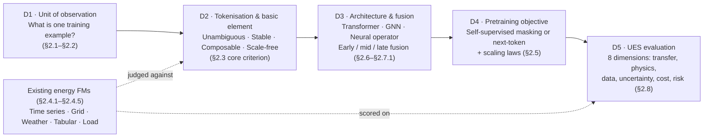

# Chapter 2 — Foundation Knowledge of Foundation Models
{: .no_toc }



The conceptual toolkit to judge any foundation-model proposal, including basic machine learning concepts for readers arriving from the energy-systems side.
{: .fs-6 .fw-300 }

*The five design decisions ([§2.2](2-2-five-design-decisions.html)) that structure every FM proposal in Chapters 4 and 5.* D2 ([§2.3](2-3-choosing-a-basic-element.html)) is the gate where transfer is won or lost before architecture or compute enter.

## In this chapter

| § | Page | Covers |
| :--- | :--- | :--- |
| 2.1 | [What defines a foundation model](2-1-what-defines-an-fm.html) | Three required properties, and the contrast with the [surrogate](../appendices/a-glossary.html#surrogate) models UES readers already know |
| 2.2 | [The five design decisions](2-2-five-design-decisions.html) | [Unit of observation](../appendices/a-glossary.html#unit-of-observation), [tokenisation](../appendices/a-glossary.html#tokenisation), architecture, objective, evaluation |
| 2.3 | [Choosing a basic element](2-3-choosing-a-basic-element.html) | **The core argument** — a criterion for choosing a [basic element](../appendices/a-glossary.html#basic-element), applied to buildings |
| 2.4 | [Existing FMs relevant to energy](2-4-existing-fms-relevant-to-energy.html) | The model families below, and what does not exist yet: the gaps these notes are written into |
| 2.4.1 | [— Time-series FMs](2-4-1-time-series-fms.html) | [Chronos](../appendices/d-model-index.html#chronos), [Moirai](../appendices/d-model-index.html#moirai), [TimesFM](../appendices/d-model-index.html#timesfm), [TabPFN-TS](../appendices/d-model-index.html#tabpfn-ts) and the current generation |
| 2.4.2 | [— Power-grid FMs](2-4-2-power-grid-fms.html) | [GridFM-v0](../appendices/d-model-index.html#gridfm) and the closest analogue to these notes' project |
| 2.4.3 | [— Weather, geospatial & generation FMs](2-4-3-clean-energy-forecasting-fms.html) | Wind and solar forecasting FMs; [GraphCast](../appendices/d-model-index.html#graphcast), [Prithvi](../appendices/d-model-index.html#prithvi) and relevance to urban microclimate |
| 2.4.4 | [— Tabular FMs](2-4-4-tabular-fms.html) | The cell as a basic element |
| 2.4.5 | [— Load & smart-meter forecasting FMs](2-4-5-load-forecasting-fms.html) | Load-pretrained models ([BuildingsBench](../appendices/d-model-index.html#buildingsbench), [EnergyFM](../appendices/d-model-index.html#energyfm), [PowerPM](../appendices/d-model-index.html#powerpm)) and general FMs tested on load, from single buildings to whole grids |
| 2.5 | [Self-supervised pretraining, fine-tuning, scaling laws](2-5-scaling-laws.html) | ML basics for readers without an ML background |
| 2.6 | [Architectures: transformers, GNNs, neural operators](2-6-architectures.html) | ML basics, continued |
| 2.7 | [Multimodal models](2-7-multimodal-models.html) | Combining time series with building attributes, images, graphs and text; why it may matter most for UES |
| 2.7.1 | [— Fusion strategies](2-7-1-fusion-strategies.html) | Early, intermediate and late fusion; gating, FiLM, [cross-attention](../appendices/a-glossary.html#cross-attention) and bottlenecks; different rates, missing modalities, and which pattern suits which UES pairing |
| 2.8 | [Evaluation criteria for UES foundation models](2-8-ues-fm-evaluation-criteria.html) | Eight dimensions for judging a UES-FM proposal beyond the generic three-property test |

---
[← Previous: 1.4 Why Now, and How to Use These Notes](../chapter-1-background/1-4-why-now-and-how-to-use.html) · [Next: 2.1 What Defines a Foundation Model →](2-1-what-defines-an-fm.html)
