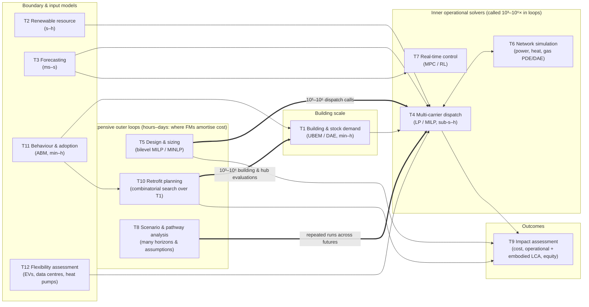

# Chapter 3 — Simulation and Optimisation in Urban Energy Systems
{: .no_toc }



The domain side, framed for an ML reader: what gets computed, with which tools, what shape the data has, and where the cost is.
{: .fs-6 .fw-300 }

*Where the computational cost lives across the twelve UES tasks ([§3.1](3-1-taxonomy-of-tasks.html)).* Single simulation or dispatch runs are usually affordable; outer decision loops (T5, T10, T8) call T1, T4 and T6 10³–10⁶ times, which is where the amortisation argument ([§3.3](3-3-energy-hub-formalism.html#the-amortisation-argument)) applies.

## In this chapter

| § | Page | Covers |
| :--- | :--- | :--- |
| 3.1 | [Modelling tasks and their mathematical structure](3-1-taxonomy-of-tasks.html) | Twelve tasks, their mathematical structure, typical runtime |
| 3.2 | [Building energy simulation: loads, datasets, benchmarks](3-2-building-simulation-data.html) | What's learnable, data shapes, benchmarks |
| 3.3 | [The energy hub: formalism, dispatch, design](3-3-energy-hub-formalism.html) | The hub formalism a hub FM must subsume or interoperate with; LP/[MILP](../appendices/a-glossary.html#milp) dispatch as an ML problem shape; bilevel design and sizing; where the computational cost actually is |
| 3.4 | [Tools and data standards](3-4-tools-and-standards.html) | Simulation, UBEM, optimisation and [co-simulation](../appendices/a-glossary.html#co-simulation) tool families; ESDL, CIM, and why neither is ML-ready |
| 3.5 | [Building retrofit and whole-life carbon](3-5-retrofit-and-whole-life-carbon.html) | Retrofit as a measure-selection task, embodied carbon of materials, [LCA](../appendices/a-glossary.html#lca) data |
| 3.6 | [Social dimensions](3-6-social-dimensions.html) | Occupant behaviour and technology adoption as inputs; [energy poverty](../appendices/a-glossary.html#energy-poverty) and justice as outcomes; social data |
| 3.7 | [Flexible loads: EV charging, data centres and heat pumps](3-7-flexible-loads.html) | Shifting, moving and curtailing load across EV charging, data centres and building thermal mass; what is measured, forecast and controlled today; why flexibility itself is not yet learned |

---
[← Previous: 2.8 Evaluation Criteria for UES Foundation Models](../chapter-2-fm-foundations/2-8-ues-fm-evaluation-criteria.html) · [Next: 3.1 Modelling Tasks →](3-1-taxonomy-of-tasks.html)
