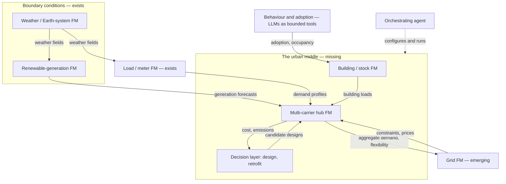

# 4.9 Putting It Together: A Future Ecosystem of UES Foundation Models
{: .no_toc }



The rest of this chapter surveys directions one at a time. This page asks how they would fit together — which models, built on which [basic elements](../appendices/a-glossary.html#basic-element), passing what to each other.
{: .fs-6 .fw-300 }

1. TOC
{:toc}

---

## Why an ecosystem, not a model

The argument of [§2.3](../chapter-2-fm-foundations/2-3-choosing-a-basic-element.html) is that a [foundation model](../appendices/a-glossary.html#foundation-model) works where its basic element suits the object it models. The existing energy FMs bear that out: grid FMs are built on the bus, meter FMs on a load time series, renewable-generation FMs on a generation site, weather FMs on a cell of a physical field ([§2.4](../chapter-2-fm-foundations/2-4-existing-fms-relevant-to-energy.html)). These elements differ, and nothing in these notes suggests one element will serve all of them. So a future urban energy system is more likely to be served by **several foundation models, each on its own element, connected at interfaces**, than by one.

This page is the notes' own synthesis, not a survey of one. A dated search (arXiv title/abstract, run 29 September 2026) combining "foundation model" with "ecosystem" and "energy" or "grid" returns 11 results, none about coupling energy-system foundation models; combining "foundation model(s)" with "coupling", "interoperab\*" or "composable" and "power system" or "energy system" returns one unrelated result.

## The components, by layer

| Layer | Component | Basic element | Status | In these notes |
| :--- | :--- | :--- | :--- | :--- |
| Boundary conditions | Weather and Earth-system FMs; geospatial FMs | Cell of a physical field; satellite [patch](../appendices/a-glossary.html#patch) | Mature not yet fused with UES data | [§2.4.3](../chapter-2-fm-foundations/2-4-3-clean-energy-forecasting-fms.html#weather-and-geospatial) |
| Boundary conditions | Renewable-generation FMs | Generation site | Mature | [§2.4.3](../chapter-2-fm-foundations/2-4-3-clean-energy-forecasting-fms.html) |
| Demand | Meter / load FMs; general time-series FMs [zero-shot](../appendices/a-glossary.html#zero-shot) | Load time series | Mature for aggregated load; open for a single building | [§2.4.1](../chapter-2-fm-foundations/2-4-1-time-series-fms.html), [§2.4.5](../chapter-2-fm-foundations/2-4-5-load-forecasting-fms.html), [§3.7](../chapter-3-sim-opt/3-7-flexible-loads.html), [§4.1](4-1-off-the-shelf-fms.html) |
| Buildings and stocks | Simulator-grounded building FM; stock-level FM | Not settled ([G8](../chapter-6-outlook/6-1-open-gaps.html#g8)) | None yet | [§4.2](4-2-fms-for-building-stocks.html), [§4.6](4-6-reading-the-screen.html#candidate-sub-fields) |
| Multi-carrier conversion | Hub / district FM | Not yet defined | None yet | [Chapter 5](../chapter-5-case-study/index.html) |
| Grid | Grid FM | Bus | Emerging first released pretrained models (2026) | [§2.4.2](../chapter-2-fm-foundations/2-4-2-power-grid-fms.html) |
| Decisions | Amortised design, retrofit, generative design | [Decision space](../appendices/a-glossary.html#decision-space) ([G9](../chapter-6-outlook/6-1-open-gaps.html#g9)) | Early single-system [surrogates](../appendices/a-glossary.html#surrogate) only | [§4.4](4-4-generative-design.html), [§4.7.3](4-7-3-methods-tier3.html), [§3.5](../chapter-3-sim-opt/3-5-retrofit-and-whole-life-carbon.html) |
| People | Behaviour and adoption | No simulator of people | Early LLMs as bounded tools | [§3.6](../chapter-3-sim-opt/3-6-social-dimensions.html), [§4.3](4-3-llm-agents-for-simulation.html) |
| Orchestration | Agents that configure and run models | Language and tool calls | Early verification open ([G7](../chapter-6-outlook/6-1-open-gaps.html#g7)) | [§4.3](4-3-llm-agents-for-simulation.html) |
| Infrastructure | Data engines, schemas, benchmarks | — | Emerging grid side only | [§3.4](../chapter-3-sim-opt/3-4-tools-and-standards.html#schemas-and-standards), [G4](../chapter-6-outlook/6-1-open-gaps.html#g4) |

Status scale: Mature working models exist and are in use · Emerging first domain models exist · Early only partial or single-case attempts · None yet nothing built yet.
{: .fs-2 }

Read down the status column and the shape of the problem is plain: **the ends exist and the middle does not.** Boundary conditions, demand and grid each have working models. The layers where urban energy systems are actually urban — buildings, multi-carrier conversion, decisions, people — have no settled element, no model, or no simulator.

## What passes between them

An ecosystem is defined less by its models than by its interfaces. Three kinds are available, and they trade off in the same way:

| Interface | What passes | Gains | Costs |
| :--- | :--- | :--- | :--- |
| **Physical quantities** | Profiles, forecasts, boundary conditions, flexibility envelopes, prices | Each model validated on its own; interface checkable in physical units; components replaceable | Information is lost at the interface; errors compound along the chain |
| **Shared learned representations** | Embeddings, or models trained jointly | Can carry what no physical quantity summarises | Components stop being separately verifiable or replaceable; needs training data spanning both sides |
| **Language and tool calls** | Requests, configurations, results | Flexible; the interface people will use | Every silently chosen assumption needs checking ([G7](../chapter-6-outlook/6-1-open-gaps.html#g7)) |

The first is what coupled tools do today. [Co-simulation](../appendices/a-glossary.html#co-simulation) — separate sub-models exchanging data at a coupling interface — is an established practice for buildings and smart energy systems, with its own taxonomic review ([§3.4](../chapter-3-sim-opt/3-4-tools-and-standards.html#tool-landscape)).[^alfalouji2023cosimulation] A learned ecosystem coupled by physical quantities is that practice with learned components substituted in, which is why it is the most reachable form. The second is the "genuinely novel scientific claim" of the case study's [Phase 5](../chapter-5-case-study/5-1-roadmap.html#phase-5-year-610--multi-scale-coupling) and the open architectural question of the grid-load bridge in [§4.6](4-6-reading-the-screen.html#candidate-sub-fields): whether two components built on different basic elements can share a representation at all.

The specific interfaces a UES ecosystem would need, and what stands behind each today:

| From → to | What passes | Today |
| :--- | :--- | :--- |
| Weather FM → load or renewable FM | Weather fields as [covariates](../appendices/a-glossary.html#covariate) | Covariate handling in time-series FMs is uneven and under-verified ([§2.4.1](../chapter-2-fm-foundations/2-4-1-time-series-fms.html)) |
| Load / renewable FM → hub | Demand and generation forecasts — ideally as distributions, not points | Standard boundary conditions for dispatch ([§2.4.3](../chapter-2-fm-foundations/2-4-3-clean-energy-forecasting-fms.html)) |
| Hub → grid | Aggregate demand; flexibility envelope (D5 in [§5.4](../chapter-5-case-study/5-4-data-modules-and-tasks.html#modules-and-tasks)) | Hand-passed between separate tools |
| Grid → hub | Network constraints; nodal prices | Hand-passed between separate tools |
| Behaviour / adoption → buildings | Adoption rates, occupancy schedules | [Agent-based models](../appendices/a-glossary.html#agent-based-model-abm) and occupant agents ([§3.6](../chapter-3-sim-opt/3-6-social-dimensions.html)) |
| Hub ↔ decisions | Candidate designs out; cost and emissions back | Single-system surrogates in the loop ([§4.7.3](4-7-3-methods-tier3.html)) |

### Templates from co-simulation

Co-simulation already standardises the physical-quantity interface, and its standards are the obvious templates for a model-to-model schema:

- **FMI (Functional Mock-up Interface)** is a tool-independent standard for exchanging dynamic models and coupling them in co-simulation, first released in 2011.[^blochwitz2011fmi] A model is packaged as a container with an XML description of its variables, units and causality, plus binaries; the standard is supported by more than 290 tools and maintained by the Modelica Association.[^fmi2026standard] Version 3.0 added clocks, scheduled execution, array and binary data types and terminals that bundle signals.[^junghanns2021fmi3]
- **HELICS** is designed for very large co-simulations, over 100,000 federates, across power-system, communication, market and end-use tools, and can iterate between federates until the physics converges at each time step.[^palmintier2017helics]
- **mosaik** composes existing, heterogeneous simulation models automatically for smart-grid studies.[^schutte2011mosaik]

Learned components can already enter this machinery. A tool that wraps neural networks in the ONNX format as FMI components has been demonstrated on a [reduced-order model](../appendices/a-glossary.html#rom) built on a recurrent neural network.[^urbani2025onnx2fmu] So the federation shape below needs no new interface standard to start with: a foundation model packaged as a co-simulation component is a learned model swapped in where a simulator used to be.

### A worked example: error along a chain

Consider the simplest chain: a load forecaster feeds a dispatch model, whose schedule sets the cost. An error in the forecast does not stay a forecasting error; it becomes a scheduling error. Under-forecasts force purchases of expensive peaking or spot-market power, and over-forecasts inflate start-up and fixed costs. For a utility, a 1% reduction in forecast error (MAPE) cut variable generation costs by about 0.1–0.3% when errors were in the 3–5% range.[^hobbs1999value]

Two findings change how such a chain should be built:

- **The most accurate forecast is not always the best input.** In a forecasting-and-scheduling competition, stochastic optimisation over forecast ensembles cut energy costs by at least 2% compared with deterministic approaches, showing that the most accurate point forecast does not necessarily give the best result downstream.[^bergmeir2025predictoptimize] This is why the interface table above asks for distributions, not points.
- **A foundation model in the chain can be tuned for the decision.** [Fine-tuning](../appendices/a-glossary.html#fine-tuning) the [Moirai](../appendices/d-model-index.html#moirai) time-series foundation model for the downstream dispatch cost rather than for forecast accuracy lowered average daily cost by 9.45% in a building dispatch problem.[^beichter2025decisionfocused] This is the closest published precedent for coupling a foundation model to a decision; extending it to a multi-carrier hub, where errors in several carriers' forecasts interact through conversion and storage, has not been done.

## Three shapes it could take

**1. One [multimodal](../appendices/a-glossary.html#multimodality) UES foundation model.** A single model with an encoder per modality — demand, weather, technology, topology, market — trained jointly: the case study's encoder stack ([§5.4](../chapter-5-case-study/5-4-data-modules-and-tasks.html#modules-and-tasks)) extended to everything. The precedent is Earth-system modelling, where one foundation model trained on more than a million hours of diverse geophysical data outperforms operational forecasts in air quality, ocean waves, tropical-cyclone tracks and high-resolution weather, and can be fine-tuned for new applications at modest cost.[^bodnar2025aurora] What makes that possible is exactly what UES lacks: every one of those tasks is posed on the same kind of element, a cell of a physical field on a shared grid. UES layers do not share an element (bus, meter series, building, hub). This shape is therefore conditional on the central open problem of these notes being solved, not an alternative to solving it. How multimodal models combine data, and the evidence so far, are in [§2.7](../chapter-2-fm-foundations/2-7-multimodal-models.html).

**2. A federation of specialist FMs coupled through physical interfaces.** Each layer keeps the element that suits it, and models exchange physical quantities as co-simulated tools do now. This is the shape the field is already drifting into by default — load, grid and weather FMs are maturing separately. Its weakness is the interface: what a forecast drops (its uncertainty, its covariance with other forecasts) never reaches the model downstream, and errors from each component stack.

**3. An agent orchestrating specialist FMs and conventional simulators.** A language model plans the task and calls the right models and tools. The closest working precedent is in computational chemistry: an agentic framework uses LLMs for task planning and scientific reasoning while calling graph-network foundation models and conventional methods up to density functional theory, evaluated on 13 benchmark tasks; smaller LLMs handled simple workflows, complex ones benefited from larger models, and decomposing tasks across multiple agents let smaller models match or exceed the larger one in some cases.[^pham2025chemgraph] Those are well-defined calculation types with checkable outputs. A UES request ("size a heat pump for this district") hides many more silent assumptions, which is [G7](../chapter-6-outlook/6-1-open-gaps.html#g7) at ecosystem scale.

**How the three relate.** They are not exclusive. The notes' reading: shape 2 is the near-term structure, shape 3 is the interface through which people will use it, and shape 1 is a research bet that depends on a shared element. The case study's hub ↔ grid coupling in Phase 5 is the first concrete test of whether a federation can move toward shared representation, and it is a better-posed test than attempting shape 1 directly.

## What an ecosystem needs that no single model does

- **An interface schema.** [§3.4](../chapter-3-sim-opt/3-4-tools-and-standards.html#schemas-and-standards) finds ESDL and CIM not ML-ready for describing a system. An ecosystem also needs a schema for what passes *between models*: quantities, units, time resolution, and uncertainty.
- **Uncertainty that survives the interface.** Criterion 6 of [§2.8](../chapter-2-fm-foundations/2-8-ues-fm-evaluation-criteria.html) applied to a chain: pass distributions or ensembles, not point forecasts, or the downstream model is confidently wrong.
- **Evaluation of the chain, not the component.** Criterion 7 of §2.8 warns that a faster model whose errors change the decision is not a better model. In an ecosystem the question becomes whether *stacked* errors change the decision — a benchmark ([G4](../chapter-6-outlook/6-1-open-gaps.html#g4)) has to score coupled outputs, not each model alone.
- **A constraint authority.** The pattern recurs across these notes: learned components propose, a constraint-aware component decides ([§4.7.3](4-7-3-methods-tier3.html)'s retrofit corollary; the validate-and-project gate in [§4.3](4-3-llm-agents-for-simulation.html)). In an ecosystem, someone has to own each constraint.
- **Shared data engines.** The grid side has a data-generation library for pretraining ([§2.4.2](../chapter-2-fm-foundations/2-4-2-power-grid-fms.html)); the multi-carrier side needs its equivalent ([Phase 0](../chapter-5-case-study/5-1-roadmap.html#phase-0-year-01--representation-and-the-data-engine)) before any of its components exist.

## What would still need to be added here

- A worked example of these notes' own, chaining a zero-shot time-series FM forecast into a multi-carrier dispatch and measuring how forecast error propagates into the decision. The published single-building precedent is above.
- Whether the interface problem should be logged as an open gap of its own in [Chapter 6](../chapter-6-outlook/6-1-open-gaps.html).

[^alfalouji2023cosimulation]: Alfalouji, Q., Schranz, T., Falay, B. et al. (2023). [Co-simulation for buildings and smart energy systems — A taxonomic review](https://doi.org/10.1016/j.simpat.2023.102770). *Simulation Modelling Practice and Theory*, 126, 102770.
[^bodnar2025aurora]: Bodnar, C., Bruinsma, W. P., Lucic, A. et al. (2025). [A foundation model for the Earth system](https://doi.org/10.1038/s41586-025-09005-y). *Nature*, 641, 1180–1187.
[^pham2025chemgraph]: Pham, T. D., Tanikanti, A., Keçeli, M. (2025). [ChemGraph: An agentic framework for computational chemistry workflows](https://arxiv.org/abs/2506.06363). arXiv:2506.06363.
[^blochwitz2011fmi]: Blochwitz, T., Otter, M., Arnold, M. et al. (2011). [The Functional Mockup Interface for tool independent exchange of simulation models](https://doi.org/10.3384/ecp11063105). *Proceedings of the 8th International Modelica Conference*, 63, 105–114.
[^fmi2026standard]: Modelica Association Project FMI (2026). [Functional Mock-up Interface](https://fmi-standard.org/). *Website*. Accessed 20 October 2026; latest specification 3.0.2.
[^junghanns2021fmi3]: Junghanns, A., Gomes, C., Schulze, C. et al. (2021). [The Functional Mock-up Interface 3.0 – New features enabling new applications](https://doi.org/10.3384/ecp2118117). *Proceedings of the 14th Modelica Conference 2021*, 181.
[^palmintier2017helics]: Palmintier, B., Krishnamurthy, D., Top, P. et al. (2017). [Design of the HELICS high-performance transmission-distribution-communication-market co-simulation framework](https://doi.org/10.1109/MSCPES.2017.8064542). *2017 Workshop on Modeling and Simulation of Cyber-Physical Energy Systems (MSCPES)*, 1–6.
[^schutte2011mosaik]: Schütte, S., Scherfke, S., Tröschel, M. (2011). [Mosaik: A framework for modular simulation of active components in smart grids](https://doi.org/10.1109/SGMS.2011.6089027). *2011 IEEE First International Workshop on Smart Grid Modeling and Simulation (SGMS)*, 55–60.
[^urbani2025onnx2fmu]: Urbani, M., Bolognese, M., Pratticò, L. et al. (2025). [A tool for the implementation of Open Neural Network Exchange models in Functional Mockup Units](https://doi.org/10.3384/ecp218645). *Proceedings of the 16th International Modelica & FMI Conference*, 218.
[^hobbs1999value]: Hobbs, B. F., Jitprapaikulsarn, S., Konda, S. et al. (1999). [Analysis of the value for unit commitment of improved load forecasts](https://doi.org/10.1109/59.801894). *IEEE Transactions on Power Systems*, 14(4), 1342–1348.
[^bergmeir2025predictoptimize]: Bergmeir, C., de Nijs, F., Genov, E. et al. (2025). [Predict+Optimize problem in renewable energy scheduling](https://doi.org/10.1109/ACCESS.2025.3555393). *IEEE Access*, 13, 60064–60087. arXiv:2212.10723.
[^beichter2025decisionfocused]: Beichter, M., Friederich, N., Pinter, J. et al. (2025). [Decision-focused fine-tuning of time series foundation models for dispatchable feeder optimization](https://doi.org/10.1016/j.egyai.2025.100533). *Energy and AI*, 21, 100533. arXiv:2503.01936.

---
[← Previous: 4.8 Building It](4-8-building-it.html) · [Back to Chapter 4](index.html) · [Next: Chapter 5 — Case Study →](../chapter-5-case-study/index.html)
