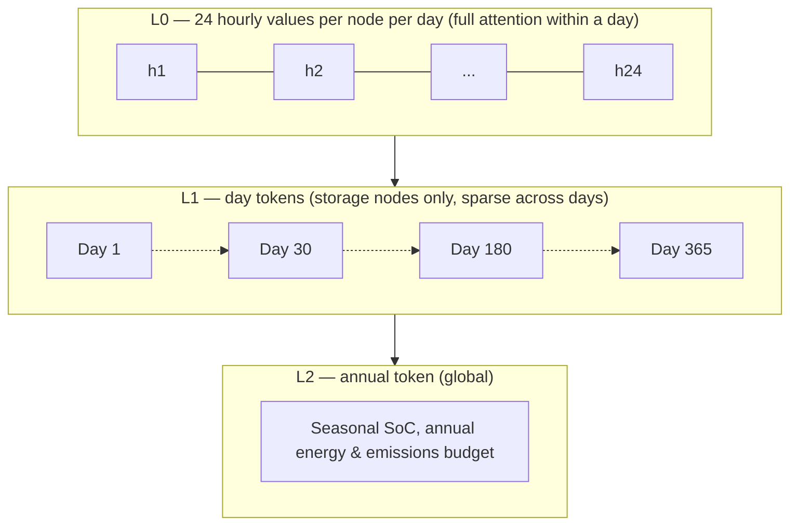

# 5.3 A Concrete Proposed Representation and Token Schema
{: .no_toc }



**In one line:** a heterogeneous bipartite graph of carrier-bus tokens and device tokens, with carrier quality as an explicit ordered dimension, over a three-level temporal hierarchy with a storage carry channel.
{: .fs-6 .fw-300 }

1. TOC
{:toc}

---

## 5.3.1 Why bipartite rather than conversion-on-edges

An edge has exactly two endpoints, so a CHP (gas in → electricity *and* heat out) or a heat pump (electricity + ambient source → heat) cannot be one edge. Making devices first-class nodes with typed ports to multiple carrier-buses handles multi-input/multi-output cleanly and gives a place to attach technology embeddings — which is what lets the model generalise to a hub containing a device configuration never seen during pretraining.

## 5.3.2 What makes this different from GridFM, not a relabelling

1. **Carrier quality is not fungible.** Heat at 80 °C and heat at 35 °C are different commodities with an ordering between them. Electricity has no analogue. The physics loss must forbid free upgrading, and the quality ordering can be encoded structurally as a directed edge. See [§5.4](5-4-data-modules-and-tasks.html#physics-loss).
2. **The token must carry a time window, not a snapshot.** [GridFM-v0](../appendices/d-model-index.html#gridfm) is snapshot-based — one solved power flow per sample. Hubs are inherently inter-temporal because of storage, and seasonal storage means the year cannot be chopped into independent windows. See the temporal hierarchy in [§5.3](5-3-concrete-representation.html).

## 5.3.3 Worked example — a 50-building district

**Carrier-buses**

| ID | Carrier | Quality | Role |
| :--- | :--- | :--- | :--- |
| B1 | Electricity | 0.4 kV | Internal LV |
| B2 | Electricity | MV | Grid connection / import |
| B3 | Heat | 75 °C | DH supply |
| B4 | Heat | 45 °C | DH return / LT loop |
| B5 | Gas | — | Import |
| B6 | Ambient | ~12 °C | Ground source |

**Devices**

| ID | Technology | Ports |
| :--- | :--- | :--- |
| D1 | CHP | B5 in → B1, B3 out |
| D2 | Heat pump | B1, B6 in → B4 out |
| D3 | Boiler | B5 in → B3 out |
| D4 | PV | exogenous irradiance → B1 out |
| D5 | Battery | B1 ↔ B1, state |
| D6 | Hot water tank | B3 ↔ B3, state |
| D7 | Borehole seasonal storage | B4 ↔ B6, state, large time constant |
| D8 | Transformer | B2 ↔ B1 |

**Quality edges:** B3 → B4 permitted (downgrade via load and mixing); B4 → B3 forbidden without a device. This one-way relation has no analogue in GridFM and is the clearest illustration of why multi-carrier systems need a different token from a grid bus (see [§2.4.2](../chapter-2-fm-foundations/2-4-2-power-grid-fms.html)).

**The numbers work.** A 50-building district with ~30 carrier-buses and ~40 devices is 70 node tokens. Per year that is 365 × 70 ≈ 25,000 tokens — within reach given [TimesFM 2.5](../appendices/d-model-index.html#timesfm-2-5) already runs 16 k context at 200 M parameters,[^das2024timesfm] and cross-day attention only needs to be dense for the handful of storage nodes (see the temporal hierarchy in [§5.3](5-3-concrete-representation.html)). The flat alternative is 8760 × 70 ≈ 613,000 tokens, which is not tractable.

## 5.3.4 Token schema

```
CARRIER-BUS TOKEN
  static:
    carrier_class      embedding [elec, heat, cold, gas, H2, biomass, ambient]
    quality            normalized scalar (K for thermal, kV for elec, bar for gas)
    exergy_factor      derived scalar, gives the model conversion limits for free
    position           (x, y) or relative encoding
    is_boundary        bool
  per temporal patch:
    net_injection      normalized profile + log-magnitude scalar (two channels)
    shadow_price       from solver duals
    unserved           slack

DEVICE TOKEN
  static:
    tech_class         embedding from a closed vocabulary
    rated_capacity     per port
    eta_params         nominal efficiency + part-load coefficients
                       + temperature sensitivity (COP curve)
    ramp / min_up / min_down / min_part_load
    capex, opex, lifetime, embodied_emissions
    age, controllability
    state_active       bool — true for storage
  per temporal patch:
    port_throughput    per port
    part_load_fraction
    on_off
    availability
    state_of_charge    active only if state_active

EDGE TYPES
  device_port     device <-> carrier-bus, typed by role (in/out) and carrier
  transport       carrier-bus <-> carrier-bus, same carrier
                  (length, capacity, loss coeff, thermal time constant)
  quality_order   carrier-bus -> carrier-bus, same site, directed downward only
```

**Two choices worth defending explicitly:**

- **Storage is a device subtype, not a fourth node type.** Keeps the vocabulary at two, and `state_active` tells the attention mechanism which nodes need cross-day routing.
- **Two-channel normalisation** — normalised profile plus explicit log-magnitude. This is the direct fix for the information-deletion problem in [§5.2.1(f)](5-2-representation-problem.html#521-the-causal-chain-representation--data--capability). Carry both from the start; magnitude cannot be recovered later by [fine-tuning](../appendices/a-glossary.html#fine-tuning).

## 5.3.5 Temporal hierarchy

| Level | Unit | Attention pattern | Carries |
| :--- | :--- | :--- | :--- |
| L0 | 24 hourly values, one token per node per day | Full attention across the graph within a day | Diurnal dispatch, conversion physics |
| L1 | Day tokens | Strided / sparse across days, **storage nodes only** | Weekly and seasonal charge cycles |
| L2 | One annual token | Global | Seasonal SoC, annual energy and emissions budget |



This hierarchy exists to solve the context-ceiling problem in [§5.2.1(d)](5-2-representation-problem.html#521-the-causal-chain-representation--data--capability): a flat year of hourly tokens per node is intractable, but full attention is only needed within a day, and cross-day routing only needed for storage nodes.

## 5.3.6 Masking tasks mapped onto the tokens

| Task | What is masked | What it teaches |
| :--- | :--- | :--- |
| M1 | Carrier-bus injections for a day | Balance-solving — the power-flow analogue |
| M2 | Device throughput | Dispatch behaviour |
| M3 | Device static attributes (capacity, η) | Attribute inference |
| M4 | A device-port edge | Which technology plausibly connects these carriers |
| M5 | Future window | Rollout |
| M6 | **Mid-year storage SoC trajectory** | Seasonal reasoning — the distinctive one, and the first to fail if the hierarchy is wrong |

These map directly onto the pretraining task suite (P1–P4) in [§5.4](5-4-data-modules-and-tasks.html#modules-and-tasks).

## 5.3.7 Invariances

- Permutation over nodes (from the graph structure)
- Scale (from two-channel normalisation)
- Carrier-quality ordering (structural, via directed downgrade edges)
- **Not** time-shift — diurnal and seasonal phase matter, so absolute time-of-day and day-of-year must be encoded

## 5.3.8 Minimum viable v0

Ship this first, prove the premise, then add:

- Single site, no spatial network (drop transport edges)
- Three carriers, two heat quality levels
- No seasonal storage, no L1/L2 hierarchy — day-level tokens only
- M1 and M2 only
- Fixed device vocabulary of ~8 classes

If that does not beat a tuned [reduced-order model](../appendices/a-glossary.html#rom) on held-out device configurations, the representation is wrong — learned in months rather than years. See [risk 5](5-5-risks.html#551-five-risks-most-likely-to-kill-the-programme).

[^das2024timesfm]: Das, A., Kong, W., Sen, R., Zhou, Y. (2024). [A decoder-only foundation model for time-series forecasting](https://arxiv.org/abs/2310.10688). ICML 2024. arXiv:2310.10688. TimesFM 2.5's 16k-context, 200M-parameter release is a later version documented at the [project repository](https://github.com/google-research/timesfm), not in the original paper.

---
[← Previous: 5.2 The Representation Problem](5-2-representation-problem.html) · [Back to Chapter 5](index.html) · [Next: 5.4 Data, Modules and Training Tasks →](5-4-data-modules-and-tasks.html)
