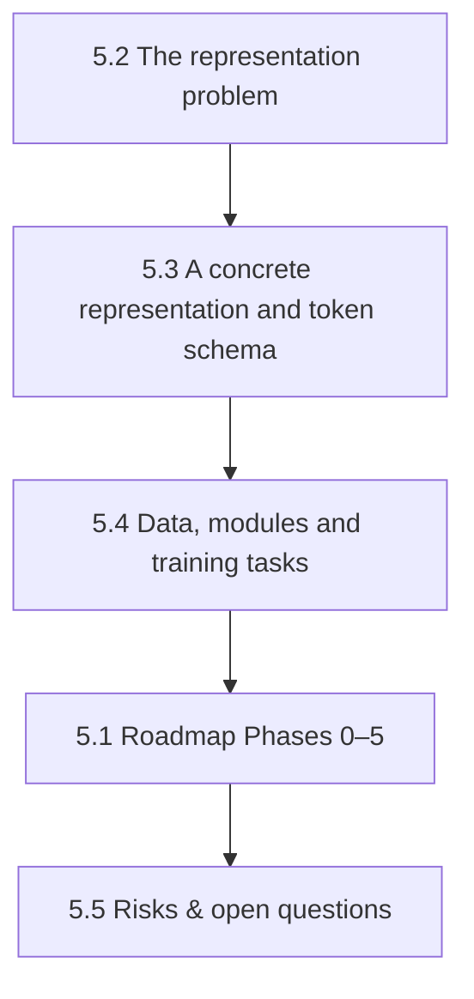

# Chapter 5 — Case Study: A Foundation Model for Multi-Carrier Energy Hubs
{: .no_toc }



One specific, opinionated proposal, worked through in full technical depth: representation, token schema, module decomposition, a phased roadmap, and the risks that could kill it.
{: .fs-6 .fw-300 }

{: .note }
**This chapter is a case study, not a survey.** It commits to one representation and one roadmap, where [Chapter 4](../chapter-4-directions/index.html) deliberately stayed neutral across many directions. Treat everything here as one group's specific bet, argued in full — not as "what the field has established."

## In this chapter

| § | Page | Covers |
| :--- | :--- | :--- |
| 5.1 | [A roadmap for a multi-carrier energy hub FM](5-1-roadmap.html) | Phases 0–5, from representation to multi-scale coupling |
| 5.2 | [The representation problem](5-2-representation-problem.html) | Why representation is four decisions, and the causal chain from representation to capability |
| 5.3 | [A concrete representation and token schema](5-3-concrete-representation.html) | Bipartite graph of carrier-bus and device tokens with a worked 50-building example; the full token schema, temporal hierarchy, masking tasks, invariances and minimum viable v0 |
| 5.4 | [Data, modules and training tasks](5-4-data-modules-and-tasks.html) | Sampling design for the case study; encoders, pretraining tasks and benchmark suite; the physics-loss inventory |
| 5.5 | [Risks and unsettled design questions](5-5-risks.html) | Five risks most likely to kill the programme; three unsettled questions |

---
[← Previous: 4.9 A Future Ecosystem of UES FMs](../chapter-4-directions/4-9-ecosystem.html) · [Next: 5.1 A Roadmap for a Multi-Carrier Energy Hub FM →](5-1-roadmap.html)
